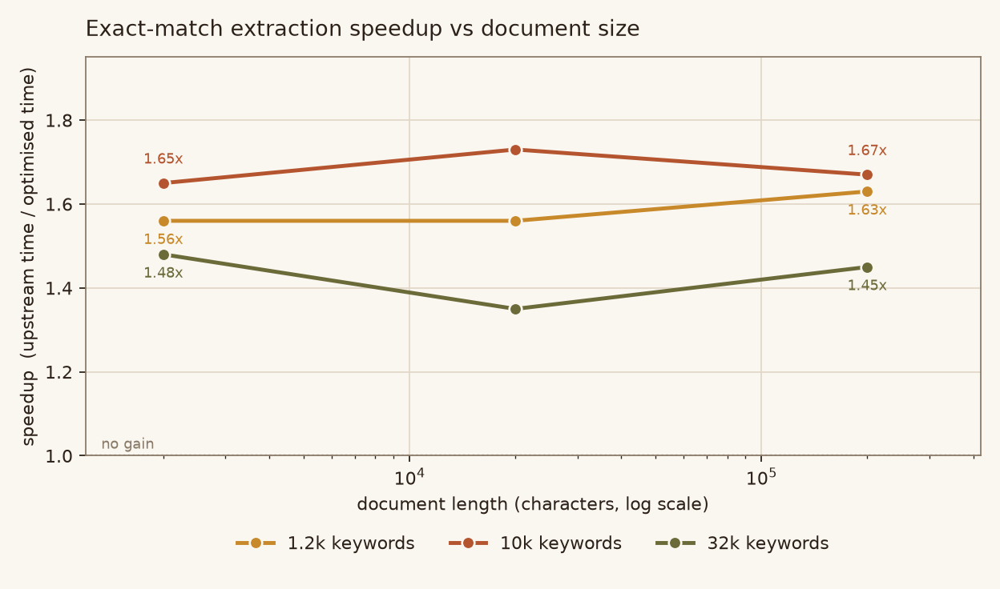
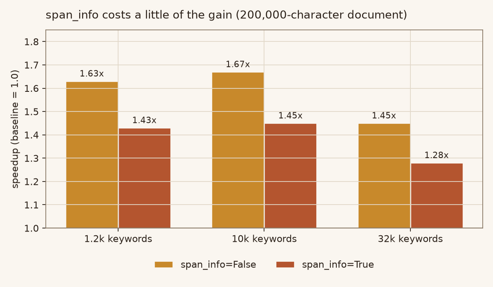
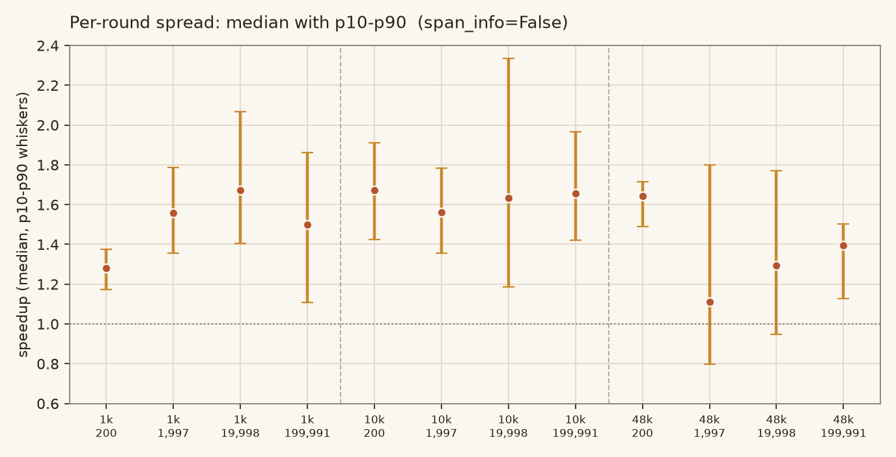

# flashtext-opt-lab

An optimisation of **[vi3k6i5/flashtext](https://github.com/vi3k6i5/flashtext) 2.7**
(MIT, 5.7k stars) — a keyword extraction / replacement library built on a
character trie.

The exact-match path (`max_cost=0`) is rebuilt on top of a token-level index.
Output is **bit-identical** to upstream; extraction is **1.3–1.8x faster** on real
text, with no configuration regressing.



---

## The problem

`extract_keywords()` walks the trie one character at a time in Python:

```python
while idx < sentence_len:
    char = sentence[idx]
    if char not in self.non_word_boundaries:   # boundary handling
        ...
    elif char in current_dict:                 # advance trie
        current_dict = current_dict[char]
    else:                                      # miss: skip to end of word
        ...
```

Every character costs a loop iteration plus a set test plus a dict test, whether
or not it can start a keyword. Measured cost: **170–175 ns/char**, flat across
document sizes. A C-level tokenisation plus one dict lookup per token does the
same work in **30 ns/char** — so the loop is ~5x more expensive than the
exact-match case requires.

## The fix

For `max_cost == 0` upstream can only *start* a candidate at the beginning of a
`[0-9A-Za-z_]+` run and only *accept* it at the end of one. That makes the result a
pure function of the document's runs and the keyword set, so:

1. **Single-token keywords** go into a plain dict — one lookup per token, no
   per-character Python loop.
2. **Multi-token keywords** (`new york`) need the *exact* separator characters
   upstream demands, so they use `str.startswith` on the full keyword — but only
   after a `(token0, token1)` gate. Without that gate, 32k keywords leave up to
   535 candidates for one token and the "optimisation" is slower than upstream.
3. **Anything not representable** (a keyword beginning with a separator, e.g.
   `.NET`) makes the fast path decline and the original loop run unchanged.

The fuzzy path (`max_cost > 0`) is not touched.

## Results

Interleaved A/B, median of per-round ratios, one subprocess per configuration.

| keywords | doc chars | speedup (`span_info=False`) | speedup (`span_info=True`) |
|---|---|---|---|
| 1.2k | 2,000 | 1.56x | 1.48x |
| 1.2k | 200,000 | 1.63x | 1.43x |
| 10k | 20,000 | 1.73x | 1.55x |
| 10k | 200,000 | 1.67x | 1.45x |
| 32k | 20,000 | 1.35x | 1.25x |
| 32k | 200,000 | 1.45x | 1.28x |

Whole books (Project Gutenberg, 0.58M–1.24M characters), outputs compared
element by element:

| book | chars | hits | identical | speedup |
|---|---|---|---|---|
| Pride and Prejudice | 732,275 | 91,137 | yes | ~1.6x |
| Sherlock Holmes | 581,601 | 73,736 | yes | ~1.6x |
| Moby Dick | 1,238,312 | 153,527 | yes | ~1.6x |
| A Tale of Two Cities | 776,912 | 98,468 | yes | ~1.6x |



**Caveats, stated up front.** On 200-character documents the absolute times are
~20 µs and the gain is meaningless. Some individual rounds dip below 1.0x — a
gen-2 GC pause landing inside one sample (one run showed a single 22.5 ms
outlier among 1.9 ms samples); `min-of-N` and the interleaved median agree on
1.3–1.7x. The p10–p90 spread is plotted below, unedited.



## Verification

* `tests/upstream_reference.py` is a byte-identical copy of upstream
  `keyword.py` (33,406 bytes); `tests/test_exact_fast_path.py` diffs the two on
  handwritten cases, span boundaries, `update=` mappings, index invalidation,
  the fuzzy path, and **400 randomised fuzz rounds**.
* **10 deliberate bugs were injected one at a time; all 10 were caught.** The
  first attempt caught only 8 — the two survivors exposed genuine coverage holes
  (no shared-prefix phrase pair, no mutation after a first extraction), and the
  suite was extended until they failed too.
* Upstream's own 39 tests pass unchanged.
* Whole-book extraction found a real bug (the `is--` tails bucket) that the
  synthetic fuzz alphabet missed.

```
$ python -m pytest tests -q
11 passed
$ PYTHONPATH=opt_pkg python -m pytest test -q
39 passed
```

## Layout

```
upstream/            untouched upstream package (reference)
baseline_pkg/        same, importable as `flashtext` for A/B benchmarks
opt_pkg/             the optimised package  <-- the deliverable
test/                upstream's own 39 tests
tests/               differential + fuzz tests (frozen upstream copy inside)
bench/               benchmark.py, minof.py, e2e.py, make_figures.py, results.json
data/                benchmark inputs built from Project Gutenberg texts
charts/              generated figures
docs/OPTIMIZATION.md full report
docs/keyword.py.patch  complete diff against upstream
```

## Reproduce

```bash
python -m pytest tests -q
PYTHONPATH=opt_pkg python -m pytest test -q
python bench/benchmark.py --rounds 25
python bench/minof.py
python bench/e2e.py
python bench/make_figures.py     # needs matplotlib
```

## Licence

Upstream is MIT, `Copyright (c) 2017 Vikash Singh`; `LICENSE` is included
unchanged. All modifications are confined to `opt_pkg/flashtext/keyword.py` and
marked with `MODIFIED (optimisation)` comments; see `docs/keyword.py.patch`.
